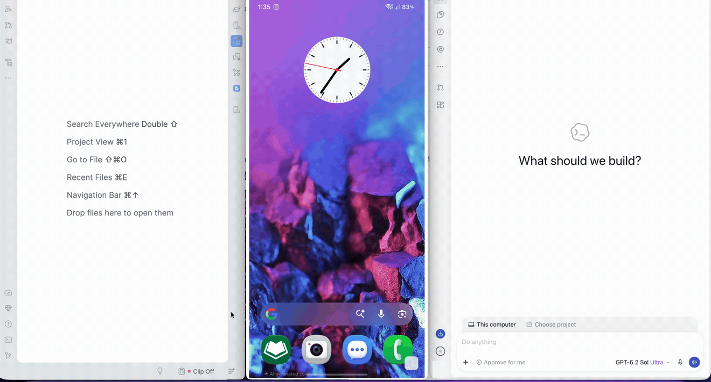

# DroidClip Plugin

I test mobile games and apps on my phone and dictate feedback to Codex and Claude Code. Sometimes it's easier to show where a character got stuck than to explain it out loud.

Ishwaq Ekhande's [droid-clip](https://github.com/Matzo02/droid-clip) got the screenshot onto my clipboard. I wanted a button I could click when I needed it, without opening a terminal or remembering a command. So I adapted the bridge for my Mac and put that button in Android Studio.

[Watch the sharper video](https://github.com/AlaaZarifa/droidclip-plugin/releases/download/plugin-v0.1.1/droidclip-demo.mp4)

## Install

- [Download the plugin ZIP](https://github.com/AlaaZarifa/droidclip-plugin/releases/download/plugin-v0.1.1/droidclip-plugin-0.1.1.zip) and leave it zipped.
- In Android Studio, open **Settings → Plugins → ⚙ → Install Plugin from Disk…**
- Select the ZIP, click **Open**, and restart Android Studio if prompted.

On macOS, use Android Studio **2026.1 (build 261.x)** with **Node.js 18+** and an Android phone connected through ADB (USB or wireless). Click **Clip Off** in the bottom bar. When it turns green, take a screenshot on the phone and paste it with **⌘V**. Click again to switch it off.

## Credits

Original CLI by **Ishwaq Ekhande (Matzo02)**. Android Studio plugin and changes to macOS clipboard handling and screenshot detection by **Alaa Abuzarifa**. [Original project](https://github.com/Matzo02/droid-clip) · [Bridge licence](LICENSE) · [Plugin licence](android-studio-plugin/LICENSE)

[Build from source](android-studio-plugin/README.md) · [CLI and connection help](MACOS.md)
